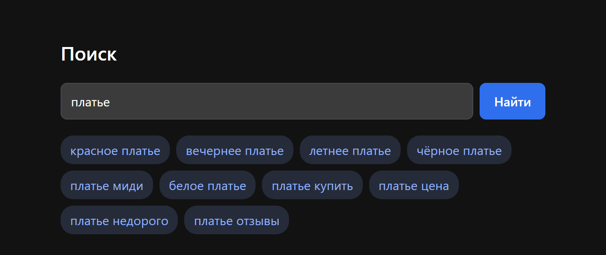
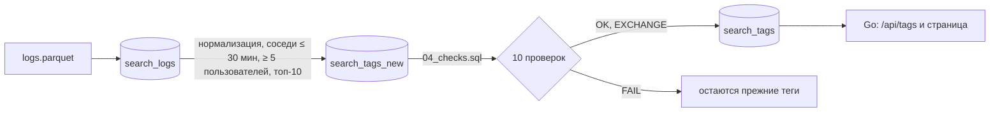

# Поисковые теги

[](https://github.com/EWEEEL/search-tags/actions/workflows/ci.yml)

Показывает под строкой поиска 10 самых популярных следующих запросов. Теги строятся по логам в ClickHouse, отдаёт их сервис на Go.



## Запуск

Нужен Docker. Положите датасет в `data/logs.parquet` (в репозиторий он не входит) и выполните:

```bash
docker compose up --build
```

`db-init` загружает логи, собирает теги в отдельную таблицу, прогоняет 10 SQL-проверок и только потом публикует результат. Дальше: [страница](http://localhost:8080/), [API](http://localhost:8080/api/tags?q=платье) (`[{"tag":"красное платье","users":9264}, …]`), `/healthz` и `/readyz`. Порт, таймаут и пароль меняются через `cp .env.example .env`. Без Docker сервис запускается так: `CLICKHOUSE_PASSWORD=clickhouse go run ./cmd/server`.



**Результат:** 992 318 строк и 50 078 пользователей → 2 632 запроса после нормализации → 90 819 пар → 4 110 пар с ≥ 5 пользователями → 1 716 тегов для 197 запросов. Все проверки пройдены.

## Почему так

- **`MergeTree`:** логи загружаются партиями и дальше только читаются, дедупликация и предагрегация не нужны.
- **`ORDER BY (user_id, timestamp)`:** запросы пользователя лежат рядом и сжимаются лучше, таблица на 16% меньше, чем с `(timestamp, user_id)`. Окно может читать её в этом порядке без сортировки (`optimize_read_in_window_order`), но на миллионе строк параллельная сортировка быстрее (24 мс против 57), поэтому настройка выключена.
- **Типы:** `LowCardinality(String)` для запроса (11 тыс. написаний на 992 тыс. строк, вдвое меньше `String`), `DateTime64(3, 'UTC')` с кодеком `Delta` (таблица ещё на 27% меньше), `UInt64` как в Parquet. Партиции по месяцам: удаление старых логов и TTL без перезаписи.
- **`search_tags`:** `ORDER BY (query, rank)` отдаёт теги одним чтением по ключу в нужном порядке. Сломанная или неполная сборка до сервиса не доходит.
- **Нормализация** в Go повторяет `lowerUTF8` из ClickHouse символ в символ, тесты сверяют их на всех 1,1 млн кодовых точек Unicode.

## Допущения

- Ровно 30 минут входят в интервал. В `A, A, B` пара `A → B` считается от последнего `A`. Пары направленные, пользователи считаются за весь период логов.
- При равном числе пользователей порядок задаёт `tag` по алфавиту, при одинаковом времени у пользователя — текст запроса.
- Ботов отдельно не фильтруем: порог по пользователям отсекает их, с ними и без них результат одинаковый. `ё` и `е` — разные буквы.

## Проверки

Где закрыт каждый пункт задания: [`docs/requirements.md`](docs/requirements.md). Данные и замеры: [`docs/data_notes.md`](docs/data_notes.md). Ежедневный пересчёт: [`docs/daily_recalculation.md`](docs/daily_recalculation.md). Результаты последнего запуска лежат в [`results/`](results/), на запущенном стеке их пересобирает `bash scripts/collect-results.sh`.

```bash
go test ./...
```

```bash
CLICKHOUSE_PASSWORD=clickhouse go test -tags=integration ./tests/integration/
```

```bash
docker compose exec clickhouse sh -c 'clickhouse-client --user app --password "$CLICKHOUSE_PASSWORD" --database search --param_table=search_tags --queries-file /sql/04_checks.sql'
```
